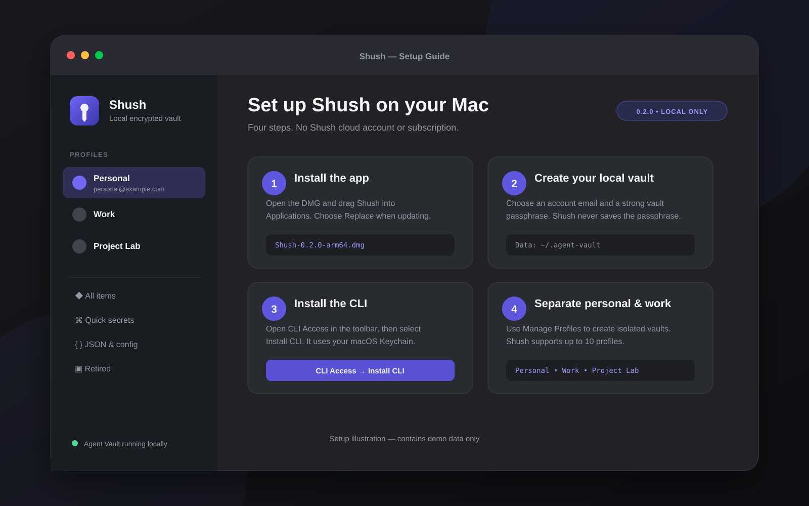
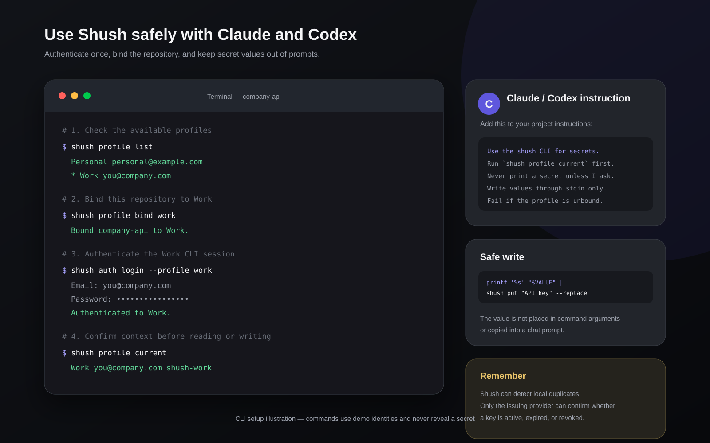

# Shush

Shush is a local-first macOS secret manager for people and coding agents. It
stores secrets in an encrypted [Infisical Agent Vault](https://github.com/Infisical/agent-vault)
running only on your Mac and provides a native app plus an authenticated `shush`
CLI for Claude, Codex, and shell workflows.

Shush does not require a Shush cloud account or subscription.

[Install](#install-the-app) · [CLI](#install-the-cli) ·
[Claude and Codex](#use-shush-with-claude-or-codex) ·
[Profiles](#personal-work-and-project-profiles) ·
[Security](SECURITY.md) · [Release history](CHANGELOG.md)

**[Download Shush from the GitHub Releases page](https://github.com/divi-vijayakumar/Shush/releases)**

## Why Shush if Agent Vault already has a UI?

[Agent Vault](https://github.com/Infisical/agent-vault) already provides a web
management interface, CLI, multi-tenancy, and credential brokering. Shush does
not replace those capabilities. It packages Agent Vault into a native macOS
workflow for people who want one local place that both they and their coding
agents can use without maintaining a paid secrets service.

Shush adds a personal desktop experience around that foundation:

- Drag in `.env`, JSON, certificates, and other credential files.
- Scan Desktop and Downloads for likely keys, import them, then optionally move
  the source download to the recoverable macOS Trash.
- Keep up to 10 named personal and work profiles, with separate account
  sessions and vaults.
- Bind a project to a profile so Claude or Codex does not silently use the wrong
  vault.
- Let humans manage, rotate, retire, and bulk-delete values in the app while
  agents use the authenticated `shush` CLI.

It is aimed at the vibe coder who does not want keys scattered through Notes,
downloads, shell history, or project files—and does not want another hosted
subscription just to organize local projects.

There is an important security distinction: `shush get` returns plaintext to
the requesting local process. That makes existing coding-agent workflows easy,
but the agent can then see the value. For higher-risk or remotely executed
agents, use Agent Vault's brokered proxy workflow so the agent never receives
the underlying credential.

## How to use it

1. Install and unlock Shush, then drag in a credential file or run **Secret
   Sweep** to review likely keys found locally.
2. Open the profile menu, choose **CLI Access…**, and install the bundled CLI.
3. Bind each project to the correct profile and tell Claude or Codex to use
   `shush` instead of asking you to paste keys:

   ```bash
   cd ~/Projects/my-app
   shush profile bind personal
   shush auth login
   shush list --json
   shush get "Stripe test key"
   printf '%s' "$NEW_VALUE" | shush put "Stripe test key" --replace
   ```

Use this instruction with an agent:

```text
Use the shush CLI for secrets in this project. Run `shush profile current`
before reading or writing. Never print a secret unless I explicitly request it.
Use stdin for writes and `--replace` for rotations.
```

## Requirements

- Apple Silicon Mac
- macOS 14 Sonoma or newer
- About 100 MB of free disk space

Shush 0.2.0 is an early local build. Check the GitHub Release description to
see whether a particular DMG is Developer ID signed and Apple-notarized.

## Install the app

1. Open the [repository's **Releases** page](https://github.com/divi-vijayakumar/Shush/releases)—not the **Code** download menu—and
   expand **Assets** under the latest release. Download
   `Shush-0.2.0-arm64.dmg` and `Shush-0.2.0-arm64.dmg.sha256`. The DMG is a
   release asset; it is intentionally not committed to the source repository.
2. Verify the download:

   ```bash
   shasum -a 256 Shush-0.2.0-arm64.dmg
   cat Shush-0.2.0-arm64.dmg.sha256
   ```

   The hashes must match.
3. Open the DMG and drag `Shush.app` into Applications.
4. A Developer ID-signed and notarized release opens normally. An explicitly
   marked development build may require Control-clicking `Shush.app`, choosing
   **Open**, and confirming **Open**.
5. Create the first local account and choose a vault passphrase. Save that
   passphrase in a safe place: Shush does not store or recover it.

Your encrypted data lives under `~/.agent-vault`, outside the application. To
update Shush, quit it, install the newer app over `/Applications/Shush.app`, and
choose **Replace**. Your vault remains intact.

## Install the CLI

The CLI is already bundled in the app. After installing Shush:

1. Open and unlock Shush.
2. Open the profile menu at the top of the sidebar and select **CLI Access…**.
3. Select **Install CLI**.
4. Ensure `~/.local/bin` is on your `PATH`.

For zsh, add this once to `~/.zshrc` if necessary:

```bash
export PATH="$HOME/.local/bin:$PATH"
```

Open a new terminal and verify the command:

```bash
shush version
shush auth login
shush auth status
shush list --json
```

The CLI stores its authenticated session in macOS Keychain. The Shush app or
local Agent Vault backend must be unlocked before the CLI can connect.

For the complete walkthrough, including project bindings and agent prompts, see
[docs/SETUP.md](docs/SETUP.md).

## Visual setup

### App setup



### CLI, Claude, and Codex setup



## Use Shush with Claude or Codex

Agents can list, read, and write secrets through the same local vault:

```bash
shush list --json
shush get "Stripe Secret key"
printf '%s' "$NEW_VALUE" | shush put "Stripe staging key"
printf '%s' "$ROTATED_VALUE" | shush put "Stripe production key" --replace
```

`put` accepts values only through standard input so plaintext is not placed in
command arguments or shell history. `--replace` retires the previous encrypted
value instead of silently overwriting it.

A useful instruction for a coding agent is:

```text
Use the shush CLI for project secrets. Run `shush profile current` before any
secret operation. Never print a secret unless I explicitly ask to reveal it.
```

## Personal, work, and project profiles

Shush supports up to 10 profiles. Each profile has a separate account session,
encrypted Agent Vault vault, item index, and CLI session.

Switch profiles in the app from the profile menu in the sidebar, or with:

```bash
shush profile list
shush profile use personal
shush profile current
```

Bind a project directory so agents use the correct profile instead of the last
globally selected profile:

```bash
cd ~/Work/company-api
shush profile bind work
```

Commands run in the bound directory or its children use that profile.
`--profile <name>` and `SHUSH_PROFILE` provide explicit overrides. If a binding
references a missing profile, the CLI fails closed rather than falling back to
another profile.

An agent may initiate a profile request:

```bash
shush profile request work --email you@company.com
```

Review the request under **Manage Profiles** in Shush and enter the account
password directly in the app. The agent never creates, receives, or views the
human password. The requested email must already be a user of the local Agent
Vault; creating or inviting human accounts remains an administrator action.

Removing a Shush profile removes its saved session from the Mac. It does not
delete the encrypted vault or copy secrets into another profile.

## What Shush provides

- Encrypted local storage for secrets and files up to 24 MB
- JSON, TFVars, `.env`, YAML, certificates, text, and binary file support
- On-demand reveal and automatic clipboard clearing after 60 seconds
- High-confidence local scanning for provider-prefixed credentials and private
  keys, with previously imported or ignored matches suppressed
- Confirmed, recoverable source-file cleanup through the macOS Trash
- Replacement history through retired encrypted values
- Command-click and Shift-click bulk retirement or deletion
- Local duplicate detection by normalized name and SHA-256 value fingerprint
- Account email display and account-password changes
- Authenticated CLI access with per-profile Keychain sessions

## Validity, duplicates, and retirement

A stored credential is not necessarily a valid credential. Shush cannot
universally determine whether a provider has expired, rotated, or revoked a key.
Provider validity requires a provider-specific API request, so the app reports
**Provider validity not checked** unless such an integration exists.

Duplicate detection means that another active item has the same normalized name
or local value fingerprint. It does not prove that either credential is valid.
Older items receive a fingerprint the next time they are revealed.

Retiring a credential changes only its state in Shush. It does not revoke that
credential at Stripe, GitHub, Google, or another provider.

## Troubleshooting

### `shush: command not found`

Install the CLI from **Profile menu → CLI Access…**, then add
`$HOME/.local/bin` to your `PATH` and open a new terminal.

### The CLI cannot connect

Open Shush and unlock the local vault first. Then run:

```bash
shush auth login
shush auth status
```

### The wrong profile is active

From the project directory, inspect and bind the intended profile:

```bash
shush profile current
shush profile list
shush profile bind work
```

### Secret Sweep finds an old download

Imported and ignored matches are suppressed on later scans. Immediately after
an import, choose **Keep File** to leave the source where it is, or choose
**Move to Trash** to perform a recoverable cleanup. Shush never moves the file
without confirmation.

## Security boundaries

- The backend binds to `127.0.0.1`.
- Vault contents are encrypted at rest by Agent Vault.
- The master vault passphrase is passed through standard input and is never
  saved by Shush.
- App and CLI sessions are stored in macOS Keychain.
- Account passwords are never displayed or recoverable.
- Changing an account password does not change the separate vault-unlock
  passphrase.
- Profile metadata contains labels, emails, vault names, and identifiers but no
  secret values or passwords.
- Copying plaintext for chat sends it to the selected chat provider; Shush asks
  for confirmation first.

## Build from source

The repository includes the official Agent Vault v0.39.0 Apple Silicon binary
under its bundled license. Its verified SHA-256 checksum is:

```text
ffc4703f425f816116c1a43ffd7ba1ed970090a87fa22507cd6cf5bbcbc493dd
```

Build and test:

```bash
swift test --disable-sandbox
swift build -c release --disable-sandbox
```

Or open the checked-in Xcode project and build the shared scheme:

```bash
xcodebuild -project Shush.xcodeproj -scheme Shush \
  -destination 'platform=macOS,arch=arm64' build
```

Build the app and DMG:

```bash
scripts/build-dmg.sh
```

Artifacts are written to:

```text
build/Shush-0.2.0-arm64.dmg
build/Shush-0.2.0-arm64.dmg.sha256
```

Generated builds are ignored by Git. See [RELEASING.md](RELEASING.md) for the
release process.

## Project status and licensing

Local development builds use ad-hoc signing. Public builds support Xcode
cloud-managed Developer ID signing as well as the manual `scripts/build-dmg.sh`
notarization workflow; see
[docs/APPLE_DISTRIBUTION.md](docs/APPLE_DISTRIBUTION.md).

The bundled Agent Vault binary is covered by
[`Vendor/AGENT_VAULT_LICENSE.txt`](Vendor/AGENT_VAULT_LICENSE.txt). Shush's own
source code is available under the [Apache License 2.0](LICENSE).
