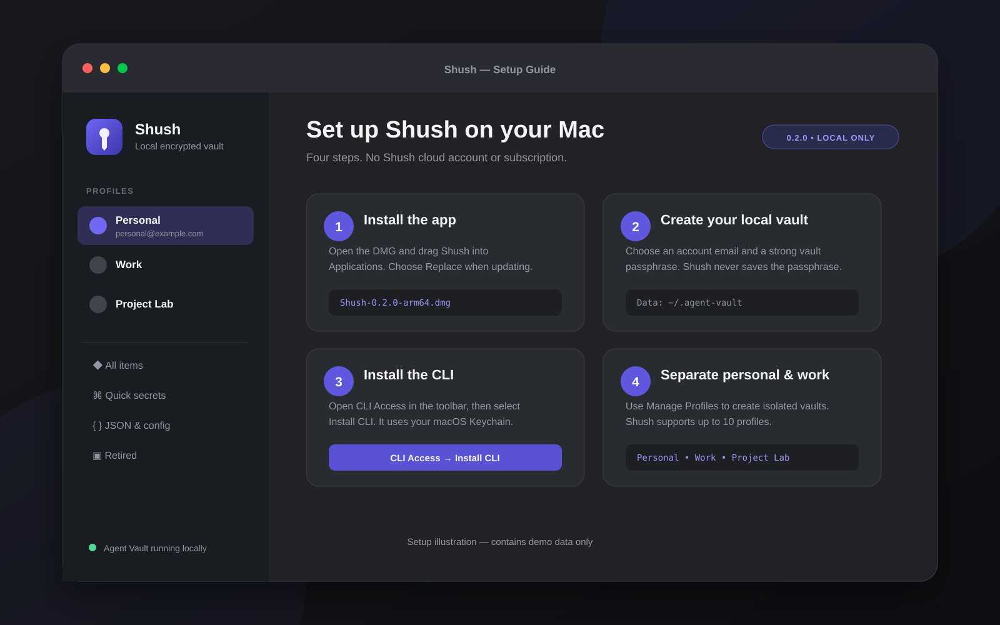

# Set up Shush

This guide covers the Shush app, CLI, profiles, and safe use from Claude or
Codex. Shush 0.2.0 supports Apple Silicon Macs running macOS 14 or newer.

## 1. Install and unlock the app

1. Download the DMG and matching `.sha256` file from GitHub Releases.
2. Compare the checksum using `shasum -a 256`.
3. Drag `Shush.app` to Applications.
4. On the first launch of the current unnotarized build, Control-click the app,
   select **Open**, and confirm.
5. Create the local owner account and choose a vault passphrase.

The account password authenticates the app and CLI. The separate vault
passphrase unlocks encrypted storage after a restart. Shush cannot display or
recover either password.



## 2. Install and authenticate the CLI

In Shush, open the profile menu at the top of the sidebar, select **CLI
Access…**, and select **Install CLI**. This creates
`~/.local/bin/shush` without administrator access.

Add the directory to zsh once if necessary:

```bash
echo 'export PATH="$HOME/.local/bin:$PATH"' >> ~/.zshrc
source ~/.zshrc
```

Open and unlock Shush, then authenticate:

```bash
shush version
shush auth login
shush auth status
shush list --json
```

## 3. Separate personal and work profiles

Create or add profiles in **Profile menu → Manage Profiles…**. Shush supports
up to 10 profiles, each with its own account session and encrypted vault.

Select the intended profile from the app menu or CLI:

```bash
shush profile list
shush profile use work
shush profile current
```

Inside a project, create a binding so the CLI and agents fail closed instead of
silently using the last-selected profile:

```bash
cd ~/Work/company-api
shush profile bind work
```

The binding is stored as `.shush-profile`. Decide whether that non-secret file
belongs in the project repository or in its `.gitignore`.

## 4. Give Claude or Codex safe instructions

Use this project instruction:

```text
Use the shush CLI for project secrets. Run `shush profile current` before every
secret operation. Never print or paste a secret unless I explicitly request it.
Use stdin for writes, and use `--replace` when rotating an existing value.
```

Common commands:

```bash
shush list --json
shush get "Stripe staging key"
printf '%s' "$NEW_VALUE" | shush put "Stripe staging key" --replace
```

Values passed to `put` are read from standard input, keeping plaintext out of
command arguments. A value returned by `get` is still plaintext; do not place
it in logs, chat, source control, or command output unless necessary.


## 5. Import and clean up downloads

Secret Sweep looks for high-confidence credentials in readable files on the
Desktop and in Downloads. Scanning is local. Review every match before import.

After a successful import:

- **Keep File** dismisses the result and leaves the source untouched.
- **Move to Trash** asks for confirmation and performs a recoverable cleanup.
- **Ignore** remembers a match without importing it.

Imported and ignored values are suppressed on future scans for that profile.
Shush never empties the Trash or revokes credentials at their providers.

## 6. Update Shush

Quit Shush, open the newer DMG, and replace the app in Applications. The
encrypted vault remains under `~/.agent-vault` and is not stored inside the app.
The CLI symlink continues to point into the installed app.
